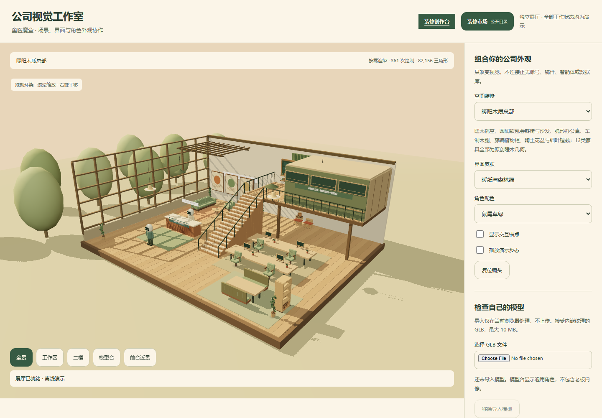

# 公司视觉工作室

北京童医魔盒科技服务有限公司模拟经营游戏的视觉协作仓库。设计师可独立改界面、装修和家具，主游戏直接使用同一份源码。

这是**公开的视觉协作仓库，原创代码、UI 和主题采用 [MIT 许可证](LICENSE.md)**，第三方素材保留[各自许可](NOTICE.md)。本仓库不是完整游戏服务器，没有账号数据库、稿件、聊天记录、模型凭证、付款接口、MCP 服务或后端源代码。展厅中的人物与工作状态全是演示。



另见[冷蓝主题实际截图](docs/images/cyber-showroom.png)；均为本展厅截图，不是概念效果图。

## 启动

需要 Node.js 24.15+。

```sh
npm ci
npm run dev
```

打开 http://127.0.0.1:5312/ 。同机已经运行正式公司时，不要再开第二个公司实例；先使用截图审阅，或在独立设计电脑运行。端口占用时明确报错，不自动换端口。

```sh
npm test
npm run validate
npm run check:publish
npm run build
```

`dist/` 是纯静态展厅，支持子路径托管。无须账号、OCTOP、DeepSeek、数据库或任何环境变量。初次加载需要浏览器支持 WebGL。

## 可以改什么

| 路径 | 用途 |
| --- | --- |
| `src/office.ts` | 当前双层建筑、灯光、家具与通用角色的可编辑 Three.js 源码 |
| `src/ui/game-shell.ts` | 主游戏入口与 HUD 外壳 |
| `src/ui/workflows/` | 10 个真实前端界面模块：登录/投稿/审批、员工、任务、会客、稿酬、招聘等；通过宿主注入业务回调 |
| `src/ui/*.css` | 主游戏共用的三份样式 |
| `themes/*/theme.json` | 界面颜色、环境调色/灯光、家具资源映射、通用角色配色 |
| `public/furniture/` | 13 个 Kenney CC0 家具 GLB |
| `source/blender/furniture-library.blend` | 从这些 GLB 导入整理的可编辑家具库；不是原作者工程 |
| `apps/showroom/` | 独立展厅；演示数据仅在此目录 |
| `asset-catalog.json` | 每个运行时资源的来源、许可与 SHA256 |

默认暖阳木质总部和蓝夜研究工作室采用同一布局。界面、空间、通用角色配色可分别预览；模型台支持仅在浏览器内检查自带 GLB、蒙皮和动作。现有通用角色使用分层四肢，**不是完整的人形蒙皮角色**；老板的私人肖像模型不在仓库内。

## 参与协作

先看 [贡献指南](CONTRIBUTING.md)、[主题规范](docs/themes.md)、[Blender 工作流](docs/blender.md) 和 [主游戏接入](docs/host-integration.md)。任何人都可以 Fork/Clone → 独立分支 → 预览与检查 → Pull Request → 所有者审核；无需真实公司账号或个人凭证。

模块拆分与不可随意修改的接口见[架构边界](docs/architecture.md)。
现有颜色、排版、组件与响应式规则见[设计规范](DESIGN.md)，供设计师和开发智能体沿用；文档同时列出尚未令牌化的辅助样式。

不要通过装修包改变楼梯、碰撞、工位和门禁位置。需要新地图时先提布局迁移方案。主题不含脚本入口，不会获得后端执行权限；源码 PR 仍需人工审查，CI 通过不代表自动上线。

## 已验证与边界

主题/路径/资源检查、类型与静态构建；浏览器桌面与手机、主题切换、组件及模型导入的当次验证记录见 [验证记录](docs/verification.md)。主系统的账号、稿酬、门禁、MCP 等测试在私有主工程运行，不在此仓库假造后端。

尚无在线装修商城、任意地图编辑、协同文档编辑、远程主题自动安装或完整人形换装。浏览器 FPS 是本设备实测，不能作为多人容量承诺。
